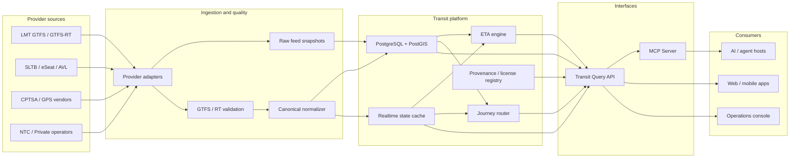

# Feasibility Study and Implementation Roadmap for a Live Sri Lanka Bus Transit MCP

## Executive summary

This study interprets the requested “MCP (Model Connector Provider)” as a **provider-facing server built on the Model Context Protocol**, whose official expansion is **Model Context Protocol**. The current MCP specification, dated July 28, 2026, defines an open JSON-RPC-based protocol through which servers expose resources and model-invokable tools to AI hosts. The current protocol is stateless at the protocol layer, and remote deployments use Streamable HTTP through a single POST endpoint. citeturn31search13turn31search5turn31search3

**Overall conclusion: the project is feasible, but feasibility differs sharply by operator.**

A useful **Lanka Metro Transit first MVP is highly feasible today**. Lanka Metro Transit has an official public live tracker and LMT-GO application, and the official application advertises real-time bus locations and arrival times updated every few seconds. More importantly for this project, Transitland and MobilityDatabase currently catalog LMT GTFS Schedule and GTFS-Realtime feeds for vehicle positions, trip updates, and service alerts. Transitland reported successful real-time retrieval when checked, while MobilityDatabase showed a current static feed version on October 20, 2026. citeturn22search0turn22search1turn23search2turn22search3

There is an important caveat: **the discoverable LMT machine-readable feeds are hosted at `api.transit.seyone.dev`, not under `lankametro.lk`, and MobilityDatabase labels them “Community Feed.”** MobilityDatabase declares CC-BY-4.0 for these feeds and reports an “official verification” date of August 18, 2026, but that is not equivalent to a direct license or API agreement from LMT. Transitland also explicitly states that downstream users remain responsible for confirming source-feed licensing requirements. Production use should therefore be conditional on written confirmation from LMT and, ideally, the `seyone.dev` feed maintainer. citeturn22search3turn22search6turn23search0turn21search2turn21search9

**Nationwide multi-provider coverage is technically feasible but institutionally conditional.** SLTB already exposes public timetables through its website/eSeat platform, and eSeat states that it provides bus tracking and fleet-management services and lets booked passengers track buses. However, this research did not locate a documented public SLTB GTFS, GTFS-Realtime, or public tracking API. citeturn25search0turn25search1turn25search4 CPTSA similarly advertises official passenger applications with real-time tracking and operates a live-tracking service, but no documented open GTFS/GTFS-RT API was found. CPTSA's published GPS-vendor list also indicates a heterogeneous telemetry environment, including GT800, GPS 303F and Teltonika FMB920 equipment. citeturn25search3turn28search1turn28search3

The recommended strategy is therefore **not to promise nationwide live coverage in the MVP**. Build a provider-neutral platform around LMT first, validate it for 6 to 8 weeks, and negotiate SLTB, CPTSA and NTC/private-operator access in parallel.

| Dimension | LMT | SLTB | CPTSA | Private / NTC ecosystem |
|---|---:|---:|---:|---:|
| Static machine-readable data | **High** | Medium-low | Medium-low | Low-medium |
| Public real-time machine-readable data | **High** | Low | Low | Low / fragmented |
| Evidence live telemetry exists | **High** | **High** | **High** | Medium-high |
| Integration difficulty | Low-medium | High | High | Very high |
| Rights/provenance confidence | Medium | Low until agreement | Low until agreement | Low until agreement |
| MVP suitability | **Excellent** | Phase 2 | Phase 2 | Phase 2/3 |
| Feasibility rating | **Green, conditional** | **Amber** | **Amber** | **Amber-red** |

**Recommended delivery:** approximately **92 to 124 person-days for a production-quality LMT-first MVP**, achievable in roughly **9 to 11 calendar weeks** with two full-time engineers plus fractional QA/transport-domain support. Multi-provider expansion should be budgeted separately at roughly **130 to 220 additional person-days**, mainly because provider access and data normalization rather than MCP implementation become the dominant problems.

The most important go/no-go decision is not technical. It is:

> **Can the project obtain an authoritative, redistributable, production-safe source for each operator's schedule and live data?**

For LMT, that question looks likely to be resolvable. For SLTB, CPTSA and private buses, it remains **unknown** and should be treated as a contractual dependency rather than an engineering assumption.

## Scope, objectives and prioritized requirements

The system should be thought of as a **Sri Lanka transit data platform with an MCP interface**, rather than as an MCP server that directly scrapes operator websites. That distinction is fundamental. MCP is the final query interface for AI clients; normalization, validation, routing, arrival prediction, provenance and provider integration belong beneath it. MCP's current architecture is explicitly intended for servers that expose structured tools and resources to AI hosts. citeturn31search0turn31search2

The core objective is to provide an AI agent with answers to questions such as:

> “Where is the next CM01 bus near Makumbura?”

> “What buses arrive at this stop in the next 20 minutes?”

> “How do I travel from Rajagiriya to Pettah right now?”

> “Is this arrival based on live GPS or only on the timetable?”

The last question is especially important. Every result should disclose **provider, source, timestamp and freshness**, so that an LLM cannot present stale timetable information as live data.

The initial scope should include scheduled service, real-time vehicle positions, trip updates, service alerts, stop discovery, route discovery, arrival estimation and simple journey planning. Payments, ticket purchasing, user accounts, driver information, complaints and personally linked travel histories should be outside the MVP. LMT-GO itself supports fare payments and collects or may collect personal, financial and device information, which is a strong reason to keep the MCP integration isolated from account/payment functionality. citeturn22search1

### Functional requirement baseline

| Priority | Requirement | Acceptance criterion |
|---|---|---|
| **MVP / P0** | GTFS Schedule ingestion | New feed can be downloaded, parsed and atomically activated; invalid versions do not replace the last known-good dataset. |
| **MVP / P0** | GTFS-RT VehiclePositions | Positions are ingested continuously; every returned vehicle includes `observed_at`, source and freshness state. |
| **MVP / P0** | GTFS-RT TripUpdates | Predictions are associated with canonical trip/stop IDs; unresolved trip references are quarantined and measured. |
| **MVP / P0** | Service alerts | Active alerts can be queried by route, trip or stop. |
| **MVP / P0** | Nearby stops | Given coordinates and radius, return ordered stops with distance, routes and provider. |
| **MVP / P0** | Next arrivals | Return scheduled and/or live arrival times with explicit `prediction_type`. |
| **MVP / P0** | Vehicle lookup | Query by route, trip or geographic bounding box. |
| **MVP / P0** | Route/search metadata | Route, direction, stop sequence and service-period queries work without an LLM having to interpret raw GTFS. |
| **MVP / P0** | MCP server | All core read operations are exposed through validated MCP tool schemas. |
| **MVP / P0** | Provenance | Every response identifies operator, upstream source, retrieval time and license status. |
| **MVP / P0** | Stale-data protection | Real-time results older than the freshness threshold are marked stale rather than silently returned as live. |
| **MVP / P1** | Basic journey planning | Finds valid direct and transfer journeys for data contained in active feeds, with walking/transfer assumptions made explicit. |
| **MVP / P1** | ETA fallback | If upstream trip predictions are unavailable but GPS is present, provide an internally predicted ETA and label it as such. |
| **Phase 2** | Multi-provider routing | A journey can cross LMT, SLTB, CPTSA/private services where data agreements and feeds exist. |
| **Phase 2** | SLTB adapter | Authorized schedule and live telemetry ingestion. |
| **Phase 2** | CPTSA adapter | Authorized routes, timetables and GPS ingestion, potentially through multiple vendor integrations. |
| **Phase 2** | NTC/private integration | Normalize NTC route/timetable data and partner telemetry from private operators or aggregators. |
| **Phase 2** | Sinhala/Tamil aliases | Search stops/routes using English, Sinhala and Tamil names and common variants. |
| **Phase 3** | Occupancy/accessibility | Return occupancy and accessibility only when an authoritative provider source supplies them. |
| **Phase 3** | Historical analytics | Reliability, headway adherence, travel-time distribution and route performance. |
| **Phase 3** | Adaptive ETA models | Route/time/day-specific models trained after enough actual stop-passage ground truth exists. |

GTFS defines the static transit dataset structure, while GTFS-Realtime provides the standard real-time layer. The current GTFS guidance recommends stable public feed locations, persistent entity identifiers and regular maintenance; canonical validators exist for both scheduled and real-time feeds. citeturn21search7turn21search3

An important proposed distinction is:

```text
scheduled arrival
    timetable only

provider_live arrival
    supplied directly by an upstream TripUpdate

derived_live arrival
    calculated by this platform from current GPS position

stale arrival
    most recent live information exceeded freshness SLO
```

This should be represented in the API rather than hidden in descriptive text.

### MVP quantitative acceptance targets

These are **proposed engineering targets**, not claims about current provider performance.

| Measure | MVP target |
|---|---:|
| Cached query p95 | < 750 ms |
| Uncached query p95 | < 2.0 s |
| MCP tool p95 end-to-end | < 2.5 s |
| Platform API availability | ≥ 99.5% monthly |
| Production target after stabilization | ≥ 99.9% |
| Successful ingestion attempts when source reachable | ≥ 99% |
| LMT live-data target | p95 entity age < 60 s when upstream is healthy |
| Stale threshold for vehicle/trip data | 90 s |
| Alert stale threshold | 10 min |
| Orphan real-time trip/route IDs | < 0.5%, with all exceptions observable |
| Corrupt feed activation | 0 |
| Coordinate leakage into application logs | 0 exact user-coordinate values |
| ETA pilot target, 5-15 min horizon | median absolute error < 2 min |
| ETA pilot target, 5-15 min horizon | p90 absolute error < 5 min |

The proposed 90-second and 10-minute stale thresholds align with official GTFS-Realtime best-practice guidance, which says TripUpdates and VehiclePositions should not be older than 90 seconds and Service Alerts should not be older than 10 minutes. citeturn21search30

## Data sources and provider-by-provider integration

The source inventory below separates **official rider-facing systems** from **machine-readable feeds**. A public website or mobile application demonstrates that data exists; it does not automatically confer API or redistribution rights.

### Source inventory

| Provider/source | URL | Access / format | Observed freshness | Coverage | Redistribution/legal status |
|---|---|---|---|---|---|
| **LMT official SmartMetro** | `https://lankametro.lk/en/smartmetro` | Public web tracker | Real-time rider-facing | MetroBus network | Site content all-rights-reserved; tracker access does not itself grant API reuse. citeturn22search4 |
| **LMT-GO** | Google Play package `com.lankametrotransit.lmtgo` | Official Android app | App says arrivals update every few seconds | LMT service | App/API terms must be confirmed; avoid reverse engineering authenticated/private endpoints. citeturn22search1 |
| **LMT GTFS Schedule** | `https://api.transit.seyone.dev/api/v1/gtfs/download?agency=LMT` | HTTP download, GTFS ZIP | MobilityDatabase had Oct. 20, 2026 dataset; registry checks daily | Current feed reports LMT service through Dec. 31, 2027 | Registry declares CC-BY-4.0, but feed is labeled Community Feed. Confirm authority directly. citeturn22search3 |
| **LMT VehiclePositions** | `https://api.transit.seyone.dev/api/v1/realtime/vehicle-positions?agency=LMT` | HTTP, GTFS-RT Protocol Buffers | Transitland reported successful retrieval when checked | LMT live vehicles | Registry/community source, CC-BY-4.0 according to MobilityDatabase. Written confirmation recommended. citeturn23search0turn23search2 |
| **LMT TripUpdates** | `https://api.transit.seyone.dev/api/v1/realtime/trip-updates?agency=LMT` | HTTP, GTFS-RT Protocol Buffers | Live source | LMT predictions | Same provenance issue. citeturn23search2turn22search6 |
| **LMT Alerts** | `https://api.transit.seyone.dev/api/v1/realtime/alerts?agency=LMT` | HTTP, GTFS-RT Protocol Buffers | Live source | LMT service alerts | Same provenance issue. citeturn23search2turn22search7 |
| **Transitland LMT catalog** | `https://www.transit.land/operators/o-lanka~metro~transit` | Registry/API/archive | Continuously indexed | LMT | Transitland requires users to respect source-feed licenses. citeturn22search2turn21search9 |
| **SLTB official site** | `https://www.sltb.lk/` | HTML/public services | Current schedules advertised | Nationwide SLTB | No open GTFS/API license located in this study. citeturn25search0 |
| **SLTB eSeat / 1315** | `https://sltb.eseat.lk/` | Web/app, timetable and booked-bus tracking | Operational tracking exists | Primarily bookable long-distance SLTB | Collaboration between SLTB and Hands Global; site says all rights reserved. Public API rights unknown. citeturn25search1turn25search4 |
| **NTC timetables** | `https://www.ntc.gov.lk/Bus_info/time_table.php` | Public HTML | Unknown | Inter-provincial / regulated services | No machine-readable redistribution license located. Permission required for systematic reuse. citeturn13search4turn25search2 |
| **NTC route map** | `https://www.ntc.gov.lk/Bus_info/route_map.php` | Public HTML/map | Unknown | National route information | License unknown. citeturn10search7turn25search2 |
| **CPTSA apps** | `https://tsa.cp.gov.lk/mobile-app.php` | Official passenger/operator apps | Advertises real-time tracking | Central Province | No open machine-readable license located. citeturn25search3 |
| **CPTSA live tracker** | `https://tsa.cp.gov.lk/live_tracking/` | Public web application | Live | Central Province participating buses | API details unknown; permission required before backend reuse. citeturn26search0turn26search2 |
| **CPTSA GPS vendors** | `https://tsa.cp.gov.lk/gps.php` | Published vendor/device registry | Current website | Central Province private buses using participating devices | Valuable integration lead, but telemetry API/ownership terms unknown. citeturn28search1turn28search3 |
| **bus.lk** | `https://bus.lk/` | Private booking/live-tracking platform | Unknown | Participating private intercity buses | Commercial partner, rights unknown; partnership preferable to scraping. citeturn13search13 |
| **Magiya.lk** | `https://magiya.lk/` | Private live GPS platform | Unknown | Participating fleets | Commercial terms unknown. citeturn17search3 |

There is a notable current inconsistency in third-party catalog metadata: Transitland's operator page shows six LMT lines, while MobilityDatabase's October 20 static feed page reports seven routes. citeturn22search2turn22search3 This is exactly why the platform should treat feeds as versioned data and build automated change detection rather than hard-code the number of routes.

### Lanka Metro Transit integration

**Recommended adapter:** native GTFS Schedule plus native GTFS-Realtime.

Estimated work: **12 to 20 person-days**.

Risk: **medium**, despite low technical difficulty.

The adapter should poll the GTFS static endpoint periodically, calculate a feed checksum, validate a new version and activate it only after validation. The real-time poller should consume VehiclePositions, TripUpdates and Alerts separately. Transitland confirms those three real-time endpoint types and showed the source as successfully fetched when checked. citeturn23search2

The major pre-production issue is provenance. The current machine-readable source is `seyone.dev`, while the official passenger systems are on the LMT domain. MobilityDatabase explicitly calls these feeds Community Feeds even though it records a CC-BY-4.0 license and an official-verification date. citeturn22search3turn22search6turn23search0

**Required go/no-go question to LMT:**

> “Does Lanka Metro Transit authorize `api.transit.seyone.dev` as a production/public GTFS and GTFS-Realtime source, and may applications cache, derive predictions from, and redistribute responses from these feeds under CC-BY-4.0?”

Until that is answered, the prototype may use the public feed while the public production service should remain conditional.

### SLTB integration

**Recommended adapter:** negotiated partner API from SLTB/eSeat/AVL infrastructure, plus a static timetable-to-GTFS transformation if native GTFS is unavailable.

Estimated work:

- **25 to 45 person-days** with a documented partner API.
- **45 to 70 person-days** if schedules must be transformed and vehicle/trip mapping reconstructed from nonstandard systems.

Risk: **high**.

SLTB has strong evidence that the raw capabilities exist. The official eSeat platform says it provides bus tracking and fleet-management services, and passengers who reserve eligible services can track the bus after departure. Its timetable interface exposes route, origin, destination, departure and arrival data. citeturn25search1turn25search4turn25search7

The constraint is access rather than telemetry. No documented public GTFS, GTFS-RT, websocket or REST tracking interface was identified in this research. This does **not** prove one does not exist internally.

The first technical workshop should therefore request:

```text
route master
stop/stage master
scheduled journeys
vehicle master
vehicle -> scheduled journey assignment
AVL/GPS positions
event timestamps
cancellations
service alerts
fare/stage information
API authentication/rate limits
data ownership and redistribution conditions
```

Do not build production integration by scraping ticket-search pages unless SLTB explicitly approves it.

### CPTSA integration

**Recommended adapter:** CPTSA central API if one exists internally; otherwise build vendor-specific AVL adapters behind one CPTSA abstraction.

Estimated work:

- **20 to 35 person-days** if CPTSA provides a canonical API.
- **40 to 60 person-days** if multiple GPS vendors must be normalized independently.

Risk: **high**.

CPTSA publicly advertises real-time bus tracking through its passenger application. Its GPS-vendor list currently includes at least Lanka GPS Solutions with GT800, Nimbus with GPS 303F, Future Network with GT800 and RRR with Teltonika FMB920. citeturn25search3turn28search3

That strongly suggests the integration may encounter multiple vendor payloads rather than a single standard protocol. The adapter contract should therefore accept a minimal canonical AVL event:

```json
{
  "provider": "CPTSA",
  "vehicle_id": "provider-scoped-id",
  "route_id": "provider-route-or-null",
  "trip_id": "provider-trip-or-null",
  "latitude": 7.2906,
  "longitude": 80.6337,
  "bearing": 120,
  "speed_mps": 8.4,
  "observed_at": "2026-10-20T08:30:00+05:30",
  "source_vendor": "vendor-id"
}
```

The high-value request to CPTSA is not “May we scrape live tracking?” It is:

> “Can CPTSA provide its post-aggregation AVL stream, route master and trip assignment interface so the project does not need four separate GPS-vendor integrations?”

### Private buses and NTC

Private-bus integration should be handled as an **ecosystem integration**, not as thousands of operator-specific adapters.

NTC is the logical first institution because its official site already provides timetable functions and describes preparation of scientific timetables for SLTB and private buses. Its public head-office contact is 241 Park Road, Colombo 05, general line 011-2587372 and hotline 1955. citeturn25search2turn32search3

Estimated Phase 2/3 effort is **35 to 80 person-days for NTC plus the first one or two aggregator/telemetry partners**, then approximately **3 to 7 person-days per additional compatible operator/vendor**. These estimates assume a stable canonical model already exists.

The integration priority should be:

```text
NTC canonical route/timetable data
              ↓
one or two large tracking/booking aggregators
              ↓
GPS platform vendors
              ↓
individual operators only where necessary
```

This approach reduces the worst project risk: creating dozens of slightly different bespoke integrations with no consistent route/trip identifiers.

## Architecture, data model and MCP contract

The recommended architecture deliberately separates upstream instability from the MCP interface.



GTFS is a particularly good canonical starting point because its current specification already models agencies, stops, routes, trips, stop times, calendars, shapes and related transit concepts using stable identifiers. citeturn21search7

The proposed canonical identifier convention is:

```text
provider:entity-type:provider-id

lmt:stop:123
lmt:route:CM01
sltb:route:88
cptsa:vehicle:xyz
```

Do not rewrite source IDs into globally meaningful numbers. Store the provider's ID unchanged behind the namespace and maintain explicit crosswalks when two systems describe the same physical stop.

Core tables should include:

| Domain | Principal entities |
|---|---|
| Provider | `providers`, `data_sources`, `source_licenses`, `feed_versions` |
| Network | `stops`, `stop_aliases`, `routes`, `route_patterns`, `shapes` |
| Timetable | `trips`, `stop_times`, `service_calendars`, `exceptions` |
| Real-time | `vehicles_current`, `trip_updates_current`, `alerts_current` |
| History | `vehicle_observations`, `predicted_arrivals`, `observed_stop_passages` |
| Cross-provider | `stop_clusters`, `route_crosswalks`, `provider_crosswalks` |
| Quality | `validation_runs`, `feed_incidents`, `stale_intervals` |

**PostgreSQL with PostGIS** is recommended for persistent data and spatial operations. A Redis-compatible in-memory cache is appropriate for the latest vehicle states and hot arrival queries. Feed archives can be moved to inexpensive object storage rather than retained indefinitely in the relational database.

Suggested caches are project design targets:

| Object | TTL / policy |
|---|---|
| Provider metadata | 1 hour |
| Routes/stops | 5-30 minutes |
| Nearby-stop query | 1-5 minutes by rounded spatial cell |
| Current vehicles | 5-15 seconds |
| Predicted arrivals | 10-20 seconds |
| Alerts | 30 seconds |
| Journey planning | 20-60 seconds, keyed by time bucket |
| Static GTFS download | Conditional HTTP/checksum, at least daily |
| Last known-good feed | Never evict until a newer validated version is active |

### Query API

MCP should sit on top of a normal typed service API:

```text
GET  /v1/providers
GET  /v1/stops/{stop_id}
GET  /v1/stops/nearby
GET  /v1/stops/{stop_id}/arrivals
GET  /v1/routes
GET  /v1/routes/{route_id}
GET  /v1/vehicles
GET  /v1/alerts
POST /v1/journeys/plan
GET  /v1/health/providers
GET  /v1/provenance/{provider}
```

This avoids coupling ingestion infrastructure to whichever AI platform invokes the service.

Every live-data response should use an envelope similar to:

```json
{
  "provider": "LMT",
  "as_of": "2026-10-20T10:15:12+05:30",
  "freshness": {
    "status": "fresh",
    "age_seconds": 12
  },
  "source": {
    "type": "gtfs_realtime",
    "url": "https://api.transit.seyone.dev/...",
    "license": "CC-BY-4.0",
    "license_status": "registry_declared_pending_provider_confirmation"
  },
  "data": []
}
```

The provenance field should not be optional.

### MCP implementation

For a new remote implementation, target **MCP protocol version `2026-07-28`**, not older tutorials based on persistent MCP sessions or the deprecated HTTP+SSE transport. The current Streamable HTTP specification uses a single POST endpoint, has no protocol-level session, requires a matching `MCP-Protocol-Version` header, and requires servers to validate the `Origin` header. citeturn31search3turn31search8

The core MCP tool set should be deliberately small:

| Tool | Purpose |
|---|---|
| `find_stops_nearby` | Find transit stops around coordinates |
| `get_arrivals` | Get upcoming arrivals at a stop |
| `get_vehicle_positions` | Get currently observed vehicles |
| `search_routes` | Find routes by number/name/place |
| `get_route` | Retrieve a route and stop sequence |
| `plan_trip` | Find direct/transfer journeys |
| `get_service_alerts` | Retrieve relevant disruptions |
| `get_feed_status` | Tell the model whether provider data is current |

MCP tools have named schemas, and the current specification supports JSON Schema 2020-12 keywords in tool input/output schemas. citeturn31search0turn31search8

A compact schema set could be:

```json
{
  "find_stops_nearby": {
    "inputSchema": {
      "type": "object",
      "properties": {
        "latitude": {"type": "number", "minimum": -90, "maximum": 90},
        "longitude": {"type": "number", "minimum": -180, "maximum": 180},
        "radius_m": {"type": "integer", "minimum": 50, "maximum": 5000, "default": 800},
        "provider": {"type": "string"},
        "limit": {"type": "integer", "minimum": 1, "maximum": 50, "default": 10}
      },
      "required": ["latitude", "longitude"],
      "additionalProperties": false
    }
  },

  "get_arrivals": {
    "inputSchema": {
      "type": "object",
      "properties": {
        "stop_id": {"type": "string", "minLength": 1},
        "within_minutes": {"type": "integer", "minimum": 1, "maximum": 180, "default": 60},
        "route_id": {"type": "string"},
        "provider": {"type": "string"},
        "limit": {"type": "integer", "minimum": 1, "maximum": 100, "default": 20}
      },
      "required": ["stop_id"],
      "additionalProperties": false
    }
  },

  "get_vehicle_positions": {
    "inputSchema": {
      "type": "object",
      "properties": {
        "provider": {"type": "string"},
        "route_id": {"type": "string"},
        "trip_id": {"type": "string"},
        "bbox": {
          "type": "array",
          "items": {"type": "number"},
          "minItems": 4,
          "maxItems": 4,
          "description": "[west,south,east,north]"
        },
        "max_age_seconds": {
          "type": "integer",
          "minimum": 1,
          "maximum": 600,
          "default": 90
        }
      },
      "additionalProperties": false
    }
  },

  "search_routes": {
    "inputSchema": {
      "type": "object",
      "properties": {
        "query": {"type": "string", "minLength": 1, "maxLength": 100},
        "provider": {"type": "string"},
        "limit": {"type": "integer", "minimum": 1, "maximum": 50, "default": 10}
      },
      "required": ["query"],
      "additionalProperties": false
    }
  },

  "get_route": {
    "inputSchema": {
      "type": "object",
      "properties": {
        "route_id": {"type": "string", "minLength": 1},
        "direction_id": {"type": "integer", "enum": [0, 1]}
      },
      "required": ["route_id"],
      "additionalProperties": false
    }
  },

  "plan_trip": {
    "inputSchema": {
      "type": "object",
      "properties": {
        "origin": {
          "type": "object",
          "properties": {
            "stop_id": {"type": "string"},
            "latitude": {"type": "number"},
            "longitude": {"type": "number"}
          },
          "additionalProperties": false
        },
        "destination": {
          "type": "object",
          "properties": {
            "stop_id": {"type": "string"},
            "latitude": {"type": "number"},
            "longitude": {"type": "number"}
          },
          "additionalProperties": false
        },
        "departure_time": {"type": "string", "format": "date-time"},
        "max_transfers": {"type": "integer", "minimum": 0, "maximum": 4, "default": 2},
        "wheelchair_accessible": {"type": "boolean", "default": false}
      },
      "required": ["origin", "destination"],
      "additionalProperties": false
    }
  },

  "get_service_alerts": {
    "inputSchema": {
      "type": "object",
      "properties": {
        "provider": {"type": "string"},
        "route_id": {"type": "string"},
        "stop_id": {"type": "string"}
      },
      "additionalProperties": false
    }
  },

  "get_feed_status": {
    "inputSchema": {
      "type": "object",
      "properties": {
        "provider": {"type": "string"}
      },
      "additionalProperties": false
    }
  }
}
```

The MCP server can additionally expose read-only resources such as:

```text
transit://providers
transit://providers/LMT/status
transit://routes/{route_id}
transit://stops/{stop_id}
transit://licenses
```

The distinction is useful: frequently parameterized queries belong in tools, while relatively stable descriptive context fits resources.

## Non-functional, security, privacy and compliance requirements

Non-functional requirements should distinguish the reliability of **your platform** from the reliability of **upstream transit data**. A service can have 99.99% HTTP uptime while returning a GPS feed that stopped updating 20 minutes ago. Those should never be represented by a single SLA number.

| Area | Requirement |
|---|---|
| Performance | p95 cached reads < 750 ms; uncached p95 < 2 s; MCP p95 < 2.5 s |
| Availability | 99.5% MVP; 99.9% production target, excluding explicitly reported upstream outage |
| Freshness | Vehicle/trip p95 age < 60 s under healthy upstream; hard stale classification after 90 s |
| Scalability | Initial design for 100 query requests/s sustained, 1,000/s burst; horizontal API/MCP scaling |
| Capacity | Design without schema redesign for at least 10,000 simultaneously represented vehicles and national-scale stop/route catalogs |
| Consistency | Static feed activation atomic; real-time entities tied to one active feed version/crosswalk |
| Recovery | Last known-good static dataset survives bad upstream releases |
| Backup | Daily database backup, point-in-time recovery where hosting tier supports it |
| Security | TLS, least privilege, secret manager, dependency/SBOM scanning, rate limits, fixed outbound adapter allowlist |
| Observability | Metrics, distributed trace ID, structured logs, feed-quality events |
| Privacy | Exact rider coordinates processed transiently by default; not retained in standard application logs |
| Accessibility | API carries accessibility values only when source authority supplies them; never infer availability |
| Internationalization | UTF-8 throughout; preserve Sinhala/Tamil source strings and normalized search aliases |

The traffic/capacity numbers above are **engineering assumptions**, because actual query volumes are currently unknown. They should be revised after a pilot.

For remote MCP, Origin validation and proper authentication are expressly recommended or required by the current MCP Streamable HTTP specification. citeturn31search3 A public production service should therefore use OAuth/OIDC or another MCP-compatible authorization model for privileged access, while anonymous public transit lookups can be placed behind aggressive rate limiting if policy permits. MCP's 2026 specification includes an HTTP authorization framework and protected-resource discovery. citeturn31search15turn31search19

Adapter services should never accept arbitrary upstream URLs from MCP callers. Provider endpoints must be configured server-side. This materially reduces SSRF and data-exfiltration risk.

### Privacy design

Sri Lanka's Data Protection Authority was established under the Personal Data Protection Act framework and states that it oversees both public and private entities. The DPA's current guidance page also lists a 2026 Gazette and Circular No. 01/2026 on application of the PDPA in the public sector, alongside guidance work on DPIAs, breach notifications and cross-border processing. citeturn29search0turn30search0

Because the PDPA was amended in 2025, and implementation details have continued changing through 2026, exact applicability and commencement requirements should be reviewed with Sri Lankan counsel or the organization's DPO rather than copied from an older compliance checklist. Parliament records the Personal Data Protection (Amendment) Act No. 22 of 2025 as endorsed on October 30, 2025. citeturn29search4

For this project the simplest compliant architecture is also the most privacy-preserving:

```text
user asks for nearby stops
          ↓
coordinates reach query service
          ↓
spatial lookup runs
          ↓
result returned
          ↓
exact coordinates discarded
```

No user account is required for ordinary transit lookup. Coordinates in tracing should be removed or coarsened. IP addresses should follow normal security-retention policy rather than being joined to mobility queries. Payment information, passenger identities, ticket histories and LMT-GO account information should never enter this MCP data plane.

Vehicle GPS can also become personal data in some circumstances when an identifier can be consistently associated with an individual driver. The public API should therefore expose an operational vehicle ID only when the provider permits it. Otherwise use a rotating/pseudonymous identifier sufficient for live tracking without publishing personnel identity.

### Proposed retention

These are **project policies, not claimed statutory periods**:

| Data class | Proposed retention |
|---|---:|
| Current realtime cache | Minutes |
| Raw GTFS-RT payload snapshots | 7-30 days |
| Normalized high-resolution AVL history | 30-90 days |
| Downsampled route-performance history | 12-24 months |
| GTFS Schedule versions | Indefinite if license permits, otherwise contract-specific |
| Standard application logs | 30 days |
| Security/audit logs | 90-180 days |
| Exact rider query coordinates | Do not persist by default |
| Provider API secrets | Until revoked/rotated, only in secrets manager |

A Data Protection Impact Assessment should be triggered before introducing persistent end-user location history, personalization, ticketing or driver-linked analytics. DPA currently publishes materials specifically addressing DPIAs and public-sector PDPA application. citeturn30search0

### Data licensing

Licensing should be enforced in software as metadata rather than treated as a README note.

Every provider should have:

```json
{
  "provider": "LMT",
  "source_authority": "pending_confirmation",
  "declared_license": "CC-BY-4.0",
  "commercial_use": "unknown_until_confirmed",
  "redistribution": "unknown_until_confirmed",
  "derived_products": "unknown_until_confirmed",
  "attribution_text": "...",
  "agreement_reference": null
}
```

Transitland itself warns users that they are responsible for confirming source-feed license requirements, even though Transitland summarizes available licenses. citeturn21search2turn21search9

Accordingly:

**LMT:** registry-declared CC-BY-4.0, but confirm authority because the source is classified as community-hosted. citeturn22search3turn23search0

**SLTB/eSeat:** do not infer reuse rights from public access. The eSeat platform identifies an SLTB/Hands Global partnership and carries an all-rights-reserved notice. citeturn25search1

**CPTSA:** treat route/tracking/GPS data as non-redistributable until written permission is received. The CPTSA site itself carries an all-rights-reserved notice. citeturn28search3

**NTC/private:** status **unknown** unless an explicit license or agreement is produced.

## Testing, deployment, monitoring and cost model

Testing must validate both conventional software behavior and **transport-data semantics**.

The canonical MobilityData validator should be part of CI and ingestion. MobilityData maintains a canonical GTFS Schedule validator, and official GTFS guidance also points to a GTFS-Realtime validator for real-time feeds. citeturn21search1turn21search3

### Feed validation plan

Static GTFS checks should include:

| Check | Failure treatment |
|---|---|
| Required files/fields | Reject feed |
| Foreign-key integrity | Reject or quarantine depending severity |
| Duplicate entity IDs | Reject |
| Invalid latitude/longitude | Reject affected rows and fail quality threshold |
| Sri Lanka geographic plausibility | Warning/error |
| Service calendar includes usable future service | Reject stale feed |
| Stop sequence monotonic | Reject trip |
| Stop times internally consistent | Reject trip |
| Shape geometry plausible | Warning/error |
| Route/trip count changes beyond configured band | Require review |
| Stop count changes beyond configured band | Require review |
| Feed checksum changed unexpectedly | Run full validation before activation |
| Persistent IDs unexpectedly churn | Quality alert |

GTFS guidance recommends persistent `stop_id`, `route_id` and `agency_id` values across dataset revisions and recommends maintaining future service coverage. citeturn21search7turn21search19

GTFS-Realtime checks should include:

```text
protobuf parses correctly
FeedHeader timestamp sane
entity timestamp sane
entity age within policy
trip_id exists in active static feed
route_id resolves
stop_id resolves
vehicle coordinates valid
vehicle coordinate movement plausible
trip update stop sequence plausible
prediction timestamp not before observation
duplicate entity IDs absent
alerts reference existing entities where required
```

An invalid upstream record should not take down the feed processor. Quarantine it, increment a quality metric and continue.

### Arrival-prediction validation

ETA quality must be measured against **actual stop passage**, not against the operator's previous prediction.

Ground truth can be derived from a combination of GPS track intersection and stop geofences. Evaluation should be split into prediction horizons:

```text
0-5 minutes
5-10 minutes
10-20 minutes
20-30 minutes
```

Report at minimum:

```text
MAE
median absolute error
p90 absolute error
RMSE
bias
percentage within ±1 minute
percentage within ±3 minutes
```

Results should be stratified by route, direction, hour, weekday/weekend and, when enough data exists, congestion conditions.

At least three baselines should be compared:

```text
static timetable
current-delay propagation
distance / recent-speed prediction
```

An ML ETA model should not ship merely because its aggregate MAE is lower. It should beat the simpler baseline across major route/time cohorts and should degrade gracefully when GPS updates become sparse.

### End-to-end MCP testing

Each MCP tool needs contract tests covering valid requests, boundary coordinates, unknown stop IDs, stale upstream data, provider outage, malformed arguments, overlarge radius requests and unavailable real-time data.

A golden end-to-end test can look like:

```text
synthetic GTFS fixture
      ↓
synthetic GTFS-RT vehicle + trip update
      ↓
adapter
      ↓
canonical store/cache
      ↓
GET /arrivals
      ↓
MCP tools/call get_arrivals
      ↓
schema-validated structured response
      ↓
assert source + timestamp + freshness + prediction_type
```

Compatibility testing should include the MCP Inspector/reference tooling family described in MCP's architecture documentation. citeturn31search2

### Deployment options

**Option A: serverless pilot**

Cloudflare Workers in front of Neon/PostgreSQL is attractive for a low-traffic proof of concept. As of October 20, 2026, Cloudflare's Workers Paid plan has a $5 monthly minimum and advertises no extra data-transfer/bandwidth charge. Neon currently lists Launch compute at $0.106 per CU-hour and permits compute to scale down when idle. citeturn32search0turn32search5turn32search17

At an illustrative continuously active average database size of 0.25 CU:

```text
0.25 CU × 730 hours × $0.106
≈ $19.35/month compute
```

So a realistic low-volume engineering estimate is:

| Component | Pilot estimate |
|---|---:|
| Edge/API/MCP | $5-20/mo |
| PostgreSQL | $10-40/mo |
| Cache/object storage | $5-25/mo |
| Logs/monitoring | $0-30/mo |
| **Likely pilot total** | **$20-115/mo** |

Those totals are estimates, not vendor quotes, and depend heavily on database duty cycle and logging volume.

**Option B: AWS/containerized production**

A conventional deployment using ECS/Fargate plus managed PostgreSQL and a Redis-compatible cache gives more predictable isolation and networking controls.

AWS currently gives a US East Linux/x86 example rate of $0.000011244 per vCPU-second and $0.000001235 per GB-second. citeturn32search2 At those specific example rates, two always-on tasks each provisioned at 0.5 vCPU and 1 GB cost approximately:

```text
2 × 730 hours ×
[(0.5 × CPU rate) + (1 GB × memory rate)]

≈ $36/month
```

That is compute only. A reasonable planning envelope after database, cache, load balancer, storage and logs is **$150 to $400/month for an early production deployment**. Actual Sri Lanka-facing region pricing must be recalculated before procurement because the cited AWS rates are specifically the N. Virginia example. citeturn32search2

**Option C: government/institutional infrastructure**

An SLTB, Ministry, ICTA or provincial data-center deployment could eliminate external recurring cloud expenditure but introduces operations, patching, networking, backup and disaster-recovery responsibilities. Cost is **unknown** without an infrastructure inventory.

### Monitoring and SLA model

Recommended metrics:

```text
upstream_poll_total
upstream_poll_failure_total
upstream_http_latency
feed_header_age_seconds
vehicle_entity_age_seconds
active_vehicle_count
trip_update_count
orphan_trip_ratio
invalid_coordinate_count
static_feed_validation_errors
feed_version_age
arrival_query_latency
mcp_tool_latency
mcp_tool_error_rate
cache_hit_ratio
eta_absolute_error_seconds
```

Use separate SLIs:

**Platform availability SLI**

```text
successful valid API/MCP requests
---------------------------------
all eligible API/MCP requests
```

**Provider freshness SLI**

```text
time periods where source age <= agreed threshold
-------------------------------------------------
all periods source expected operational
```

This prevents an upstream SLTB/LMT outage from incorrectly being treated as your server outage while still making stale transit information visible.

Suggested alerting:

| Condition | Alert |
|---|---|
| GTFS-RT entity age > 90 s for 5 min | Warning |
| Entity age > 5 min | Critical upstream freshness incident |
| No vehicles while active service expected | Warning, validate against timetable |
| GTFS poll fails 3 consecutive times | Warning |
| New static feed fails validation | Critical data-quality alert, retain previous version |
| MCP/API 5xx > 2% for 5 min | Critical |
| p95 query > 3 s for 10 min | Warning |
| ETA p90 exceeds 5 min over meaningful sample | Model-quality investigation |

Logs should be structured JSON with `trace_id`, provider, source, operation and latency, but should not contain precise user coordinates, authentication tokens or raw payment/user data.

## Roadmap, effort, open-source strategy and stakeholder engagement

A realistic plan should run legal/data-access work and engineering in parallel.

| Stage | Calendar | Person-days | Primary deliverable | Go/no-go checkpoint |
|---|---:|---:|---|---|
| Source/legal verification | Week 1-2 | 12-18 | Signed source inventory, LMT provenance assessment | **G0:** acceptable right to consume LMT source |
| Canonical model + infrastructure | Week 1-3 | 12-16 | Database, canonical IDs, deployment skeleton | Schema handles at least LMT/SLTB/CPTSA shapes |
| LMT static adapter | Week 2-4 | 8-12 | Versioned GTFS ingestion and validation | Feed passes automated quality gates |
| LMT real-time adapter | Week 3-5 | 10-14 | Vehicles, trip updates, alerts | **G1:** seven-day stable ingestion run |
| Query/cache service | Week 4-6 | 12-16 | Stops, routes, vehicles, arrivals API | p95 targets met under synthetic load |
| MCP implementation | Week 5-7 | 10-14 | MCP 2026-07-28 tools/resources | All tool schemas/E2E tests pass |
| Routing + ETA baseline | Week 5-8 | 12-18 | Journey planning and prediction baseline | **G2:** ETA beats timetable baseline |
| Security/observability/testing | Week 7-9 | 10-14 | Monitoring, alerts, threat review | No P0/P1 defects |
| Pilot and documentation | Week 9-11 | 6-10 | Public/internal pilot and docs | **G3:** production pilot approval |
| **Total LMT-first MVP** | **9-11 weeks** | **92-132** | Production-capable pilot | Rights + quality + reliability approved |

A tighter team with strong existing transit experience could fall toward the lower end. Provider/legal delays can increase calendar time without increasing engineering person-days.

A sensible staffing profile is:

| Role | MVP allocation |
|---|---:|
| Backend/transit engineer | 1.0 FTE |
| Backend/platform/MCP engineer | 1.0 FTE |
| QA/data-quality engineer | 0.25-0.5 FTE |
| Transport domain specialist | 0.2-0.3 FTE |
| Product/stakeholder lead | 0.2-0.3 FTE |
| Privacy/legal | 3-6 focused review days |

### Go/no-go gates

**G0: source authorization**

Proceed to public LMT pilot only if either LMT confirms the current source or supplies an authoritative replacement. A community feed with an apparent CC-BY license is enough for technical prototyping but is not an ideal foundation for a government-facing production product. Transitland itself places source-license verification on the downstream consumer. citeturn21search9

**G1: feed reliability**

Require at least seven consecutive days of observation with:

```text
>= 99% successful polls when endpoint reachable
no unexplained multi-hour timestamp freezes
< 0.5% unresolved RT references
no critical static GTFS validation errors
automated stale-feed detection proven
```

**G2: rider-information quality**

Journey/arrival output must beat a timetable-only baseline and not return ghost vehicles or stale predictions as live.

**G3: production security/legal**

Require provider/data license record, privacy review, dependency/SBOM scan, secrets review, retention policy and incident runbook before exposing a public endpoint.

**G4: multi-provider expansion**

Do not commit engineering work to SLTB/CPTSA adapters until a sample dataset or API sandbox has been obtained. Otherwise estimates have too much uncertainty.

### Phase expansion estimate

| Expansion | Effort |
|---|---:|
| SLTB partner/API integration | 25-45 person-days |
| SLTB data reconstruction if no API | additional 20-30 |
| CPTSA central API | 20-35 |
| CPTSA multi-vendor fallback | additional 20-30 |
| NTC/private static normalization | 20-35 |
| First private tracking/booking partner | 15-25 |
| Multi-provider routing/crosswalks | 20-30 |
| Multi-provider QA/operationalization | 20-30 |
| **Likely Phase 2 range** | **130-220 person-days** |

### Open-source release strategy

A monorepo is recommended:

```text
/transit-core
    canonical models and normalization

/adapters
    /lmt
    /sltb
    /cptsa
    /ntc

/ingestion
    schedulers, snapshots, validation

/api
    provider-neutral REST/query layer

/mcp
    Model Context Protocol server

/routing
    trip planning and ETA interfaces

/quality
    validators and anomaly rules

/infra
    deployment/IaC

/docs
    architecture, source provenance, contribution docs
```

**Apache-2.0** is recommended for source code because it permits government, academic and commercial reuse and includes an explicit patent grant. Documentation can use CC-BY-4.0 if desired.

Transit data should **not automatically inherit the source-code license**. Keep a strict separation:

```text
source code      Apache-2.0
documentation    CC-BY-4.0
provider data    governed by provider/feed license
credentials      never in repository
historical data  published only with explicit redistribution authority
```

The repository should contain:

```text
LICENSE
NOTICE
SECURITY.md
CONTRIBUTING.md
CODE_OF_CONDUCT.md
DATA_SOURCES.md
DATA_LICENSING.md
PROVENANCE.md
ARCHITECTURE.md
THREAT_MODEL.md
```

`DATA_SOURCES.md` should record URLs, ownership, date verified, machine-readable format, attribution obligations and the written authorization reference for every production source.

### Stakeholder engagement plan

**Lanka Metro Transit**

The official LMT site lists phone numbers 011-2187221 / 011-2187290 and WhatsApp +94 70 288 6886. The LMT-GO developer listing gives `ayeshmantha@lankametro.lk`, `apps@lankametro.lk`, and LMT's Sethsiripaya Stage II office address. The application listing also names EIMSKY Business Solutions Pvt Ltd as the implementation provider. citeturn22search4turn22search1

Ask for:

```text
Head of IT / digital systems
LMT-GO technical owner
real-time/AVL data owner
legal/data licensing authority
EIMSKY technical integration contact
```

Request written answers on the `seyone.dev` feeds, CC-BY-4.0 status, acceptable polling rate, cache/archive rights and whether a direct official endpoint is available.

**SLTB and Hands Global/eSeat**

SLTB/eSeat lists SLTB at No. 200 Kirula Road, Colombo 5 with +94 (0)11 7706000 and related lines; Hands Global operates the 1315 reservation service. citeturn25search1turn25search9

Approach:

```text
SLTB Chairman/GM office
Head of IT
Operations / scheduling
fleet management / AVL team
eSeat/Hands Global technical owner
SLTB legal/procurement
```

The main request should be read-only schedule + AVL access, not ticket/payment access.

**CPTSA**

CPTSA publishes No. 595 Digana Road, Kundasale, hotline 081 2222 229, office 081 2424 372 and `ta.cpclk@gmail.com`. citeturn28search3

Approach:

```text
General Manager
Assistant General Manager, IT
operations/planning
live-tracking system owner
GPS-vendor coordinator
data/legal authority
```

Its own staffing pages identify an Assistant General Manager role for Information Technology and Training, reinforcing IT as an appropriate formal contact route. citeturn26search9

Ask CPTSA whether it has a normalized AVL backend upstream of the published GPS vendors.

**National Transport Commission**

NTC's official contact is:

```text
National Transport Commission
No. 241, Park Road
Colombo 05
General line: 011 2587372
Hotline: 1955
info@ntc.gov.lk
```

citeturn32search3turn32search11

Approach the planning/timetable, IT and GPS/digital-transport teams for route master data, schedule exports, historical MyBus/GPS integration information, and permission to create GTFS for services that do not yet publish it.

**Transitland / MobilityData**

Transitland is valuable as an independent feed registry and historical cross-check, but it should not substitute for provider authorization. Transitland maintains an open catalog and archives GTFS versions, while MobilityData maintains the canonical GTFS validation tooling. citeturn21search37turn21search13turn21search3

**`seyone.dev` feed maintainer**

The current LMT machine-readable source is technically critical. The project should identify the maintainer and establish:

```text
who generates the data
whether it is transformed from an LMT source
whether LMT explicitly authorized publication
uptime expectations
change-notification mechanism
license provenance
whether the API has rate limits
```

Until those questions are answered, mark the source in the platform as:

```text
technical_status: usable
registry_status: community
declared_license: CC-BY-4.0
provider_authority: unconfirmed
production_redistribution: conditional
```

### Recommended final project decision

**GO for an LMT-first prototype and MCP platform.**

The technical evidence is unusually strong for LMT: an official live rider experience exists, GTFS Schedule is cataloged, all three principal GTFS-Realtime feed types are discoverable, and the current feed is actively indexed by major transit-data registries. citeturn22search0turn22search3turn23search2

**CONDITIONAL GO for a public production LMT service**, subject to written source/licensing confirmation.

**CONDITIONAL GO for SLTB and CPTSA**, subject to API/data-access agreements. Both organizations demonstrably possess digital scheduling/tracking capabilities, but this research did not identify open production-grade machine-readable interfaces comparable to LMT's current feed. citeturn25search1turn25search3

**NO-GO for a promise of nationwide live coverage until NTC/SLTB/CPTSA/private data agreements are obtained.** The architecture can and should be nationwide-ready from day one, but the bottleneck is institutional access, stable vehicle-to-trip mapping and redistribution authority, not MCP itself.

The most defensible project strategy is therefore:

```text
LMT authoritative-source confirmation
            ↓
9-11 week provider-neutral MVP
            ↓
6-8 week live-data quality observation
            ↓
publish open-source MCP + transit core
            ↓
SLTB + CPTSA partner adapters
            ↓
NTC/private operator aggregation
            ↓
nationwide multi-provider journey planning
```

On that path, MCP is the relatively straightforward final interface. The project's durable asset is the layer underneath it: a **licensed, validated, provenance-aware, provider-neutral real-time transit data platform for Sri Lanka**.
